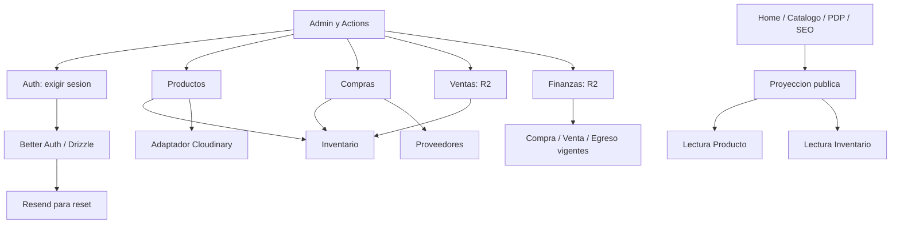
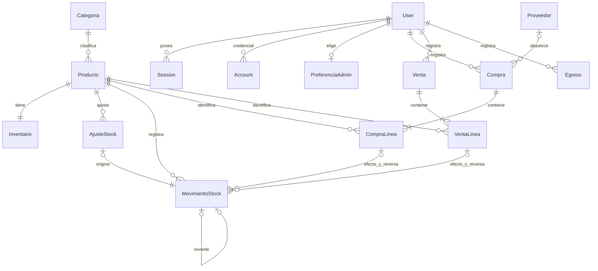

# Blueprint de implementación del MVP

**19/10/2026 — planificación aprobada por responsable; ninguna feature implementada.** Base inspeccionada: `9f1a42c` en main. Este es el plano técnico común de Emi, Claudio y Augusto. Las decisiones de negocio están en [DECISIONES_PRODUCTO_MVP](DECISIONES_PRODUCTO_MVP.md); la autoridad y el control de alcance en [AGENTS](../AGENTS.md); las referencias académicas y gaps en [TRAZABILIDAD_MVP](TRAZABILIDAD_MVP.md). OpenSpec concreta cambios futuros, no reemplaza SRS/RUP.

## 1. Estado y límites

| Existe y funciona | Es demostración / falta |
| --- | --- |
| Next 16.0.10, React 19.2, TS 5.9.3, Tailwind 4.3.3, Node 24.15, pnpm 11.25 | Persistencia, auth, reglas comerciales, uploads y suite de tests no implementados. |
| Home, contactos, navegación, acordeones, filtros locales, siete PDP mock y 404 de slug desconocido | Catálogo público independiente de saldos mock; login hace reset del formulario y `router.push`, logout solo navega. |
| Boty/shadcn/Radix reutilizables, shell administrativo y tablas con diálogos de lectura | Fixtures no definen campos obligatorios, módulos, gráficos ni comportamientos del MVP. |
| Metadata básica, HTML público inicial y noindex admin | SEO comercial, canonical, sitemap, robots y datos estructurados finales pendientes. |
| Dirección/Instagram/WhatsApp e historias reales; Street View editado con atribución | Horarios, logo limpio y catálogo comercial definitivo pendientes. |

Se inspeccionaron entradas/layouts de `app`, composición pública y shell/formulario/tablas/gráficos del admin, fixtures, imágenes alcanzables, configuración, package/lockfile y documentación. No hay `src/`, servicios comerciales, Route Handlers, migrations ni infraestructura OpenSpec previa. No reorganizar la UI para imponer una estructura nueva.

Fuera de alcance: carrito, checkout, pagos/pedidos/reservas web, cuentas de clientes, roles/multiadmin, sucursales, CMS general, ERP/contabilidad fiscal e IA. No añadir widgets configurables, campañas, rankings o categorías CRUD. Las únicas ampliaciones funcionales de esta tarea son las expresamente registradas en la actualización de producto.

## 2. Stack y compatibilidad

| Decisión | Uso futuro | Fuente |
| --- | --- | --- |
| Next.js + TS + PostgreSQL, monolito | Una aplicación, runtime Node para BD/auth/uploads | ADR-001/002 |
| Drizzle + `pg` + Drizzle Kit | Persistencia, pool, migraciones SQL revisadas y transacciones | [ADR-003](adr/ADR-003-drizzle-modelo-transacciones.md) |
| Better Auth + Resend | Identidad/sesión/reset y entrega de correo, respectivamente | [ADR-004](adr/ADR-004-better-auth-resend.md) |
| Zod | Validación de boundaries, no sustituto del dominio | [ADR-005](adr/ADR-005-zod-validacion.md) |
| Vitest + RTL + Playwright | Dominio/integración, conducta UI y E2E | [ADR-006](adr/ADR-006-testing.md) |
| Cloudinary | Una imagen principal por producto, referencia en PostgreSQL | [ADR-007](adr/ADR-007-cloudinary-imagenes.md) |
| RSC + Actions + HTTP donde corresponda | Datos frescos, mutaciones autorizadas, tema aislado | [ADR-008](adr/ADR-008-nextjs-fronteras.md) |

Consulta del registro oficial npm el 19/10: OpenSpec 1.14.3 requiere Node >=20.19; Better Auth 1.7.11 declara peers Next 14/15/16, React 18/19 y Drizzle ^0.45.2; Drizzle estable consultado 0.45.4, Zod 4.6.7 y Vitest 5.0.5 admite Node 24. No incompatibilidad declarada con el proyecto. Son evidencia de compatibilidad de planificación, **no versiones instaladas o lock funcional nuevo**. Cada implementación fija versiones compatibles y revisa cambios del registro; no migra Next por novedad ni instala prereleases para seguir un ejemplo.

Hosting, proveedor PostgreSQL, observabilidad final, analytics y CI/CD avanzado permanecen abiertos. Necesitar Node y PostgreSQL transaccional es un requisito técnico, no una elección de Vercel/Railway ni un deploy autorizado.

## 3. Módulos y ownership

Admin es un shell, no un módulo de dominio único.

| Capacidad | Propietario de datos/contrato | Ubicación futura, sin crear carpetas vacías |
| --- | --- | --- |
| Auth/Cuenta | Emi: identidad, sesiones, reset, provisión y cambio de contraseña | `lib/modulos/autenticacion`, `lib/infraestructura/auth.ts`, schema `auth.ts` |
| Productos | Augusto: Producto único, categorías fijas, slug, publicación, destacado e imagen | `lib/modulos/productos`, schema `producto.ts` |
| Inventario | Claudio: saldo, mínimo, ajustes e historial/movimientos | `lib/modulos/inventario`, schema `inventario.ts` |
| Proveedores/Compras | Claudio: proveedores, cabeceras, líneas y anulaciones | `lib/modulos/proveedores`, `lib/modulos/compras`, schemas propios |
| Catálogo/Experiencia pública/SEO | Augusto: proyección pública, Home, catálogo/PDP y metadata | `lib/modulos/catalogo`, componentes públicos existentes |
| Ventas | Ronda 2, sin responsable asignado | `lib/modulos/ventas`, schema `venta.ts` |
| Finanzas/Egresos | Ronda 2, sin responsable asignado | `lib/modulos/finanzas`, schema `egreso.ts`; resultado es consulta |
| Dashboard operativo | Ronda 2, composición de lecturas anteriores | UI admin y consultas, no base paralela |
| Preferencia visual admin | Ronda 3, sin responsable asignado | Preferencia propia por cuenta, wrapper admin |
| Infraestructura compartida | Emi coordina DB/arnés/migraciones; cambios pactados con ambos | `lib/infraestructura/db.ts`, `lib/infraestructura/esquemas/*.ts`, `drizzle.config.ts` |

Flujo proporcional: UI/Action/Handler → servicio/caso de uso → reglas puras + persistencia del módulo. No una interfaz/repositorio genérico por tabla; queries Drizzle concretas, `server-only` donde corresponda. Componentes no importan clientes de BD. Contratos públicos mínimos en archivos separados, evitando barrels que importen todo el módulo y ciclos entre servicios.

Productos necesita inicializar saldo cero en la misma transacción de alta mediante contrato de Inventario. Inventario no llama al servicio de escritura de Productos: FK y DTO interno bastan. Compras/Ventas consultan referencias de Producto y pasan IDs al contrato transaccional de Inventario; no actualizan saldos directamente. Catálogo compone lecturas; no se coloca dentro del servicio de escritura de Productos ni obliga a Inventario a importar UI pública.

## 4. Convenciones de datos

Los nombres españoles sin tildes son contratos futuros; nombres de Better Auth se preservan como exige su adaptador. ID comercial UUID generado en servidor; ID auth `text` según framework. Claves naturales solo donde se justifica: categoría y slug/email únicos, no nombres de producto/proveedor por intuición.

Dinero: `numeric(18,2)` SQL → string Drizzle → centavos bigint para multiplicar/sumar → string decimal en DTO. Nunca float para decidir un total. Entradas con más de dos decimales se rechazan antes de SQL; no confiar en que la escala impida redondeo. Cantidades enteras positivas en líneas/ajustes, saldo >=0 y mínimo null o >=0. Precio cero/signos/importes comerciales permitidos siguen pendientes: no se agregan por deducción constraints comerciales sobre dinero.

`fechaOperacion` es `date` sin hora y representa la fecha comercial real; `creadoEn`/`actualizadoEn`/`anuladoEn` son `timestamptz`. Período `[desde, hasta]` inclusivo por `fechaOperacion`; mes actual usa zona comercial `America/Argentina/Cordoba`. Carga histórica no mueve resultados al mes de carga. No se aprueba una política sobre fechas futuras por el tipo técnico.

## 5. Modelo relacional global

Es diseño, no schema ejecutable ni autorización para crear tablas de rondas futuras en Ronda 1. Ronda 1 materializa únicamente su subconjunto; Venta/Egreso/Preferencia se diseñan aquí y se migran en sus rondas. Todas las referencias comerciales usan `ON DELETE RESTRICT`; no borrado físico normal de productos/operaciones. Auth gestiona expiración/limpieza de sus datos efímeros según la librería.

| Entidad / owner | Claves, datos y relaciones | Restricciones/índices/estados | Tiempo, historia y borrado |
| --- | --- | --- | --- |
| User / Emi | `id` text PK; `name`, `email`, `emailVerified`, `image?` y campos estándar del schema generado | email único normalizado según Better Auth; una sola cuenta provisionada, sin roles | createdAt/updatedAt; sin borrado de la cuenta por UI; `image` de librería no habilita avatar editable |
| Session / Emi | PK, token único, userId FK User N:1, expiresAt, contexto mínimo de librería | índices userId/expiración y token; sesiones persistidas y revocables | timestamps del framework; logout/reset revocan; limpieza de expiradas según auth |
| Account / Emi | PK; userId FK N:1, accountId/providerId, password hash y campos de librería | credenciales Better Auth; unicidad de identidad/proveedor según schema validado; solo password habilitado | no exponer hash ni tokens; sin UI de vincular cuentas |
| Verification / Emi | PK; identifier, value, expiresAt y timestamps según versión Better Auth | índice identifier y expiración; consumo único según mecanismo del framework | token de reset efímero; nunca DTO público/log; no FK userId inventada |
| RateLimit / Emi | Tabla técnica del almacenamiento de límites de Better Auth si la versión la requiere | clave de bucket única, contador/ventana según schema generado | retención técnica limitada; no historial comercial ni pantalla |
| PreferenciaAdmin / R3 | userId PK/FK User 1:0..1; tema `claro`/`oscuro` | CHECK de dos valores; default claro; sin preferencias genéricas | actualizadoEn; asociación a cuenta; no altera productos ni público |
| Categoria / Augusto | codigo text PK estable; nombre | siete códigos sembrados, sin CRUD; FK de Producto restrictiva | etiquetas aprobadas; correcciones controladas, sin historial de catálogo ficticio |
| Producto / Augusto | id PK, slug único, nombre, precio ARS, categoriaCodigo FK, descripcion/material/medida/color/cuidados opcionales; publicado boolean; destacado boolean; version | índices slug y (publicado,categoriaCodigo,id); nombre/precio/categoría requeridos; defaults oculto/no destacado; publicación requiere imagen válida | creadoEn/actualizadoEn; no borrado físico; slug no cambia con nombre; versión evita pérdida de edición |
| Imagen principal embebida / Augusto | Producto guarda assetId/publicId/versionProveedor/urlSegura/ancho/alto/formato, todos null o conjunto completo | 0..1 por Producto, dimensiones positivas; servidor comprueba proveedor/archivo; no binarios ni URL arbitraria | reemplazo por referencia nueva después de upload; cleanup anterior postcommit; sin entidad Media/CMS |
| Inventario / Claudio | productoId PK/FK Producto 1:1; cantidad integer default 0; minimo integer nullable; version | CHECK cantidad>=0, minimo null o >=0; índice de consulta bajo mínimo según medición, no asumir `cantidad <= NULL` | actualizadoEn; no dato de saldo duplicado en Producto; no borrar con historia |
| AjusteStock / Claudio | id PK; productoId FK N:1; tipo INICIAL/INCREMENTO/DECREMENTO; cantidad positiva; motivo; actorId FK User; claveSolicitud unique y fingerprint | índice (productoId,creadoEn,id); efecto firmado según tipo, nunca saldo negativo; historial inmutable | creadoEn automático; INICIAL identificado sin compra ni efecto económico; sin reemplazo silencioso de saldo |
| Proveedor / Claudio | id PK; nombre; telefono/instagram/nota opcionales; activo boolean; version | índice (activo,nombre,id); nombre no único por deducción | creadoEn/actualizadoEn; usado no se elimina; inactivo no disponible para nueva compra; baja sin historia pendiente |
| Compra / Claudio | id PK; fechaOperacion; proveedorId nullable FK; nombreProveedorHistorico nullable; nota; total; actorId; claveSolicitud unique/fingerprint | estado CONFIRMADA/ANULADA; índice (estado,fechaOperacion,id), proveedorId; condición de campos de anulación coherente | creadoEn y anuladoEn/por opcionales según estado; sin edición ni borrado; proveedor renombrado no reescribe snapshot |
| CompraLinea / Claudio | id PK; compraId FK N:1; numeroLinea; productoId FK; nombreProductoHistorico; cantidad; costoUnitarioHistorico; subtotal calculado | unique(compraId,numeroLinea), índice productoId; cantidad>0; al menos una línea validada en transacción; no fusionar costos distintos | inmutable; subtotal/total comprobados desde líneas, nunca precio actual |
| Venta / R2 | id PK; fechaOperacion; comprador nullable; total; actorId; claveSolicitud unique/fingerprint | CONFIRMADA/ANULADA; índice (estado,fechaOperacion,id); comprador ausente se muestra Consumidor Final | creadoEn y anuladoEn/por; no entidad Cliente; sin edición ni borrado |
| VentaLinea / R2 | id PK; ventaId FK N:1; numeroLinea; productoId FK; nombreProductoHistorico; cantidad; precioUnitarioHistorico; subtotal | unique(ventaId,numeroLinea), índice productoId; cantidad>0; al menos una línea | inmutable; retener nombre/precio del registro, no costo de venta inferido |
| MovimientoStock / Claudio, extensión R2 | id PK; productoId FK, delta integer firmado, saldoResultante, actorId; tipo ORIGINAL/REVERSA; origen desde ajusteId/compraLineaId/ventaLineaId; reversaDe FK propia nullable | exactamente un origen aplicable; CHECK delta !=0 y saldoResultante>=0; reversaDe unique y presente solo en REVERSA; unique parcial por cada origen no nulo + tipo; índice (productoId,creadoEn,id) | creadoEn; append-only; no se edita/borrar; reversión referencia original. FK ventaLineaId se incorpora en R2 junto con VentaLinea, no antes |
| Egreso / R2 | id PK; concepto; importe; fechaOperacion; nota opcional; actorId; claveSolicitud unique/fingerprint | CONFIRMADO/ANULADO; índice (estado,fechaOperacion,id); campos de anulación coherentes | creadoEn y anuladoEn/por; sin edición/borrado ni categoría de gasto obligatoria |

La imagen es un grupo de columnas, no otra tabla. User/Session/Account/Verification/RateLimit conservan el contrato de su versión: generar, inspeccionar y contrastar tipos/índices antes de integrar. El control de unicidad de administradora corresponde al procedimiento y endpoints cerrados; no crear roles por esa necesidad.

Verification/RateLimit son mecanismos propios de auth y no se relacionan artificialmente con el modelo comercial. Resultado financiero y Dashboard son proyecciones, no entidades persistidas.

## 6. Contratos mínimos compartidos

Contratos de TypeScript futuros en español, sin elegir transporte REST interno. Se prueban con dobles de puertos para avanzar antes del módulo vecino; **nunca crear un segundo schema Producto como doble**.

| Contrato / proveedor | Entrada → salida | Garantías y consumidor |
| --- | --- | --- |
| `exigirAdministradora` / Auth | headers/request → identidad mínima `{id,nombre,email}` o error seguro | valida sesión en servidor en cada frontera privada; no retorna hash/token. Todos los slices privados. |
| `consultarProductosInternos` / Productos | IDs/filtro interno → id, nombre, slug, categoría, precio decimal, publicado, imagenValida | permite ocultos para venta interna; no duplica saldo. Compras/Ventas/Inventario. |
| `crearSaldoCero` / Inventario | tx + productoId → saldo 0/minimo null | solo durante alta Producto y misma tx. FK/PK impiden saldo duplicado; no efecto económico ni compra. |
| `aplicarMovimientos` / Inventario | **tx del llamador** + variaciones por ID, origen/actor → saldos/IDs afectados | locks ordenados y no negatividad; append movimiento; no abre tx independiente ni hace commit. Compras/Ventas/Ajustes. |
| `consultarDisponibilidad` / Inventario | IDs → existe stock boolean (interno puede incluir saldo/mínimo) | lectura batched; nunca asumir stock cliente como autoridad de venta. Catálogo/Productos. |
| `ProductoPublico` / Catálogo | slug o filtro → id, slug, nombre, precio decimal/ARS, categoría, imagen HTTPS/dimensiones/alt, opcionales aprobados, disponible boolean, destacado | sin proveedor/costo/actor/saldo exacto. Listados filtran publicado+stock>0; PDP publicada puede tener disponible=false. |
| `listarDestacados` / Catálogo | límite visual → `ProductoPublico[]` | destacado && publicado && cantidad>0; orden estable por ID hasta aprobar otro criterio, sin ranking nuevo. |
| `consultarResultado` / Finanzas | fechas ISO inclusivas → ventas/compras/egresos/resultado en strings ARS | suma solo fuentes vigentes en lectura consistente; fechaOperacion, sin tablas de resultado duplicadas. |
| `ResultadoOperacion` / cada módulo | comando validado → ok+ID+IDsProductoAfectados o error tipado | incluye resultado reproducible para misma clave; errores por campo/dominio sin SQL/secretos. UI conserva formulario no sensible. |

La proyección Catálogo puede hacer un JOIN SQL explícito de Producto/Inventario en su repositorio de lectura, con ownership acordado, sin pasar tablas al cliente ni crear relaciones en mocks. Así se filtra antes de serializar/paginar y se evita N+1. Las mutaciones de saldo pertenecen exclusivamente a Inventario.

Los límites Next reciben IDs afectados al completar un comando y refrescan Home/catálogo/PDP tras commit. Un módulo de dominio no importa `next/cache`, metadata, UI ni Cloudinary SDK; el adaptador de Productos sí puede usar el SDK en servidor. No existe dependencia Inventario → Público ni Productos escritura → Finanzas.

## 7. Transacciones, concurrencia y reintentos

Convención: sesión y Zod antes del servicio; dentro de la tx revalidar referencias/estado y bloquear lo que se modifica. Bloquear cabecera al anular y luego filas de Inventario ordenadas por productoId. Reunir deltas del mismo producto antes de verificar saldo, preservando líneas originales. No transacción por línea ni por módulo.

| Caso | Pasos atómicos / restricciones | Evidencia de cierre |
| --- | --- | --- |
| Alta Producto | insertar Producto oculto + crearSaldoCero con misma tx; colisión slug se resuelve sin cambiar slugs previos | ni producto sin saldo ni saldo huérfano ante fallo |
| Ajuste / saldo inicial | deduplicar clave/fingerprint; lock saldo; calcular delta; comprobar >=0; insertar ajuste/movimiento y actualizar saldo/version | motivo obligatorio, historia; INICIAL sin compra/finanzas; doble envío no duplica |
| Registrar compra | validar productos/proveedor activo si informado; calcular importes; cabecera/líneas + incrementos/movimientos en misma tx | fallo intermedio revierte todo; compra se cuenta una vez |
| Anular compra | lock cabecera; comprobar CONFIRMADA; locks saldos; demanda completa de reversión; si insuficiente rechazar; movimientos inversos y estado ANULADA juntos | venta/ajuste concurrente no permite saldo negativo; segundo intento no revierte otra vez |
| Registrar venta | mismo patrón de deduplicación; producto interno incluye ocultos; locks saldos; revisar todas las cantidades; cabecera/líneas/descuento/movimientos | dos ventas de última unidad: solo una confirma; formulario conserva cantidades al rechazar |
| Anular venta | lock cabecera; CONFIRMADA → ANULADA; reintegro/movimientos inversos en la tx | una sola reversión aun con dos solicitudes |
| Egreso / anulación | deduplicación al registrar; lock estado para anular, sin movimiento stock | sin doble egreso ni doble anulación, historial y exclusión financiera |
| Cambiar imagen | upload externo primero; lock/version Producto y referencia en tx; limpieza postcommit | se conserva anterior ante fallo; compensación del recurso nuevo si no se adjunta |
| Reset | transacción del adaptador Better Auth para consumo, credencial y revocación | enlace concurrente no cambia dos veces; fallo revierte todos los cambios |
| Finanzas / dashboard | agregado en una consulta SQL o tx read-only REPEATABLE READ si son varias | mismos cortes de datos/fechas para todas las cifras del resumen |

Un UUID de solicitud identifica una operación lógica, no un producto ni un intento de red. Unique + fingerprint en Compra/Venta/Egreso/Ajuste evita duplicación después de una respuesta perdida. Si otra tx está en curso, el unique/lock arbitra; recuperar el resultado de la misma clave tras rollback/relectura. Otro payload con la misma clave es conflicto. Anulación ya aplicada devuelve el registro actual sin repetir efecto; no éxito de una nueva reversión ficticia. Reintento técnico limitado para deadlock/serialización conserva clave, nunca loop infinito.

Índices/checks respaldan el dominio; FK no comprueba stock, Zod no arbitra concurrencia. Locks, saldo, historia e importe se verifican con PostgreSQL real. No se introduce una cola/event bus/CQRS o transacción distribuida.

## 8. Arquitectura Next.js y navegación

| Superficie futura | Organización / acceso |
| --- | --- |
| `/`, `/catalogo`, `/catalogo/[slug]` | conservar URLs y visual público; RSC consulta proyección real, Client solo filtros/controles; ningún visitante necesita sesión |
| `/admin/login`, `/admin/recuperar`, `/admin/restablecer` | públicos solo para acceso/reset, noindex; token en mecanismo de Better Auth, no segmentar una ruta propia por token sin necesidad |
| `/admin`, productos, stock, proveedores, compras, ventas | shell protegido y consultas/comandos autorizados; admin con sesión válida va del login al panel |
| `/admin/finanzas` | Resumen + Egresos; migrar navegación actual Reportes/Egresos aquí en R2, con redirección interna desde URLs legacy; sin nuevo módulo Reportes paralelo |
| `/admin/cuenta` | nombre/email visibles, cambio autenticado de contraseña y logout; sin perfil/roles inventados |
| `/admin/configuracion` | solo claro/oscuro, R3; no cuenta ni CMS |
| `/api/auth/[...all]` | Handler de Better Auth; signup deshabilitado y orígenes confiables; no omitir autorización en el resto |
| `/api/admin/productos/[id]/imagen` | multipart real, autenticado; límites del ADR-007; no REST general comercial |

Formularios comerciales: Server Actions llaman servicios y retornan resultado discriminado; no fetch HTTP a sí mismo. Loading por segmento/región, vacío de datos vs filtro, errors recuperables y `notFound` solo para inexistencia/oculto. Login/logout/reset usan las APIs de Better Auth y sus cookies mediante integración oficial, sin recrearlas en Actions propias.

Lecturas públicas inicialmente por solicitud sin caché persistente compartida y con memoización por request; metadata y render usan el mismo producto. Invalidación/refresco de paths después del commit, nunca anunciar éxito o refrescar una transacción abortada. Ya abierta una pestaña no recibe push automático: no se inventa tiempo real. Admin es privado/noindex, pero noindex no protege datos. Ver ADR-008 para caché/tema; no activar flags de runtime en esta entrega.

## 9. Auth, imágenes y seguridad

Auth: schema generado/revisado de Better Auth, provisión inicial controlada e idempotente, sin contraseña en argumentos CLI ni registros y rechazando segunda administradora. Sesión en BD con máximo absoluto de 30 días desde login, sin extensión por uso diario; vencida exige nuevo login. Verificar opciones de la versión fijada al implementar, sin configurar ahora. Cookie segura y reset por Resend con enlace de 1 hora y respuesta neutra incluso si falla el envío. Reset invalida enlace y todas las sesiones; vuelta a login sin auto-login. Nombre/email solo lectura en `/admin/cuenta`, contraseña/logout allí; `/admin/configuracion` solo tema persistente admin-only. Cambio autenticado exige contraseña actual; política de otras sesiones es el único bloqueo de ese subflujo, no de todo Auth. Reemisión de recovery pendiente según soporte nativo, sin infraestructura propia compleja. Sin registrar admin público, OAuth, roles o multiadmin.

Imágenes: primero guardar oculto con los datos obligatorios, luego adjuntar imagen y publicar. Una principal; JPEG/PNG/WebP, 3 MiB/20 MP, decoder y autorización servidor. Cloudinary servidor con ID nuevo; fallo conserva anterior; limpieza segura después del commit. Nunca secretos de proveedor, costos o datos privados en props RSC públicas. Las transformaciones CDN son acotadas, no URLs de upload arbitrarias. Ver ADR-007.

[SEGURIDAD](SEGURIDAD.md) contiene los controles transversales; no se duplican implementaciones de CSRF, hashing o validación de origen de Better Auth. Actions/Handlers son fronteras públicas aun si el botón no se muestra. Zod para formato, permisos y dominio revalidados en servidor; Drizzle parametriza valores. Identificadores/orden SQL dinámicos solo allowlist, nunca interpolación libre.

## 10. Público, SEO local y rendimiento

| Área | Criterio concreto de implementación futura |
| --- | --- |
| Home | Hero y composición curada por equipo; destacados y secciones de categoría consumen productos elegibles. Sin diseñador/CMS, orden/ranking/campañas administrables ni cards del mock como fuente. |
| Catálogo | publicado + cantidad>0; categorías fijas aprobadas; vacío/filtro/error distinguidos; HTML inicial útil y enlaces rastreables. No búsqueda avanzada/paginación como requisito inventado. |
| PDP | slug único estable; publicado agotado sigue con «Sin stock»; oculto/inexistente 404; mismo criterio para HTML/metadata/JSON-LD. Sin checkout/reserva. |
| Metadata/OG/canonical | `generateMetadata`, title/description veraces, canonical absoluto por slug, OG/Twitter con imagen real HTTPS; dominio/base URL final pendiente, nunca canonical de localhost. Probar HTML sin ejecutar JS y vista previa de plataformas que lean metadata. |
| JSON-LD | `Product`/Offer con precio ARS, URL, imagen y disponibilidad InStock/OutOfStock reales; no ratings/reviews/marca/material inventados. BreadcrumbList solo si el breadcrumb existe y refleja navegación. Serializar de forma segura ante `</script>`. |
| SEO local | identidad Angel Tears, accesorios/bijouterie en Concordia, dirección y contactos confirmados; LocalBusiness con datos comprobados y enlaces sociales. No horarios, geocoordenadas, servicios o medios de pago nuevos por inferencia; sin keyword stuffing ni páginas basura. |
| Sitemap/robots | Home/catálogo y PDP publicadas, incluidas agotadas accesibles; excluye ocultos, admin y reset. lastModified desde cambios reales. Admin con noindex y protección; robots no es mecanismo de seguridad. Dominio/HTTPS final bloquea aceptación productiva, no diseño local. |
| Accesibilidad | HTML semántico, h1 coherente, labels/errores vinculados, teclado/foco visible y gestionado, textos alternativos veraces, contraste medido y estados anunciados; no depender solo del color. |
| Rendimiento | Server Components por defecto, JS solo para interacción; imágenes con dimensiones/sizes responsive y lazy bajo el pliegue, prioridad solo LCP real; fuentes existentes sin duplicarlas, evitar CLS; medir CWV en entorno real antes de optimizar. Sin prometer cifras no aprobadas. |

Search Console/Google Business Profile son acciones externas posteriores, no endpoints o módulos del MVP. La imagen del local mantiene atribución y no se presenta como fotografía nueva. «Consultar horarios vigentes» hasta confirmación; no reemplazar la identidad pública al introducir tema admin.

## 11. Finanzas y Dashboard — diseñados para Ronda 2

Finanzas consulta ventas vigentes, compras vigentes y egresos manuales vigentes por fechaOperacion: muestra importes de cada origen y resultado aproximado, sin doble conteo. No margen, costo vendido ni ganancia contable. Mes actual por defecto, otro mes/rango; estado vacío, resultado cero/negativo y error son distintos. Egresos pertenecen a Finanzas en navegación, conservando su escritura/entidad propia; no categorías complejas ni edición de confirmados.

Dashboard operativo compone ventas del mes, resultado, stock bajo, cantidad publicada, últimas ventas y accesos útiles de módulos reales. No copiar gráficos/series del template, widgets configurables ni analytics. Las métricas candidatas no indispensables se validan en su change de R2; no transformarlas todas en RF nuevos. Cantidad publicada no equivale a cantidad elegible pública; explicitar la etiqueta usada. Sin responsable R2 asignado en esta tarea.

## 12. Ronda 1: tres changes y coordinación

| Owner / change activo | Entregables futuros y límites | Primer hito para desbloquear |
| --- | --- | --- |
| Emi — [implement-admin-auth-account](../openspec/changes/implement-admin-auth-account/proposal.md) | Drizzle común necesario para auth, Better Auth, cuenta inicial, login/sesión/logout, admin guard, recovery/Resend/reset/cambio contraseña y pruebas; sin negocio | E0: DB común/arnés/config y contrato exigirAdministradora; no esperar schema comercial |
| Claudio — [implement-inventory-suppliers-purchases](../openspec/changes/implement-inventory-suppliers-purchases/proposal.md) | Inventario, mínimos, ajustes/historia; proveedores; compras/líneas/anulación con transacciones y pruebas; consume Producto | C0: crearSaldoCero/aplicarMovimientos y DTO de disponibilidad; proveedores puede avanzar sin Producto |
| Augusto — [implement-products-public-seo](../openspec/changes/implement-products-public-seo/proposal.md) | Producto/categorías/imagen/slug/visibilidad/destacado; público real, SEO/OG/JSON-LD/sitemap/robots y pruebas; sin escribir saldo | P0: schema Producto/Categoria y DTO interno; coordinar alta+saldo con C0 |

Hitos son partes de esos tres changes, **no changes adicionales**. Pueden desarrollar con puertos/dobles de contratos sin esperar integración final, pero no publicar un catálogo con stock ficticio ni dar por probado guard con stub. E0, P0 y C0 se integran pequeños primero; el resto continúa en paralelo. Providers/validación pura/UI/SEO con fixtures de prueba pueden avanzar mientras llega infraestructura; pruebas SQL y aceptación integrada sí esperan las tablas/guard reales.

Ownership: Augusto edita `producto.ts` y público; Claudio `inventario.ts`, `proveedor.ts`, `compra.ts` y su UI; Emi `auth.ts`, DB/Better Auth/Resend y guard. Compartidos `package.json`, lock, config de tests/Drizzle y shell admin se pactan antes de editar. Emi coordina una actualización común de dependencias aprobadas y secuencia de migraciones, no servicios de negocio. Nadie genera migraciones globales simultáneas con snapshots distintos ni reescribe la historia aplicada.

Dependencia de datos: Producto → Inventario/Compras por FK; alta Producto llama contrato de saldo en tx común. Imports de schema para FK no autorizan a otro módulo a modificar campos ajenos. C0 crea saldo/ajustes/movimientos con origen de ajuste; la columna/FK de origen CompraLinea se agrega junto con Compra/Linea en el hito de compras, y VentaLinea/su columna/FK juntas en R2. Los CHECK de origen se amplían en esa misma migración. No importar schemas todavía inexistentes ni crear tablas de rondas futuras para hacer compilar Inventario inicial.

El [workflow vigente de esta etapa](GIT_WORKFLOW.md) exige main actualizado → rama propia/ownership → sincronización → integrar main reciente y resolver conflictos entendidos → tests aplicables/lint/typecheck/build/OpenSpec/diff → merge → push → aviso al equipo. PR, aprobación de otro integrante y revisión cruzada no son gates; otra revisión es recomendable y el responsable debe poder explicar el cambio. Coordinación y DoD técnica se mantienen. No aplicar ni archivar ningún change durante esta corrección documental. Todos los checks de tasks permanecen sin marcar.

## 13. Roadmap posterior, sin changes activos ni responsables

| Ronda | Trabajo futuro | Dependencias/salida |
| --- | --- | --- |
| 2 | Ventas y anulación, Egresos/Finanzas y Dashboard operativo | R1 integrada; contrato Inventario transaccional + Producto único + Auth. Reconciliar historia, efectos y fechas; no implementar durante planificación. |
| 3 | Tema claro/oscuro admin-only; integración/hardening, gaps, E2E, production readiness y deploy autorizado; SEO final/Search Console; observabilidad al decidir | R1/R2 probadas, fuentes/pendientes de producto resueltos según capacidad; hosting/DB/secretos/backups/HTTPS acordados. Sin asignar owners ni crear carpetas de changes futuros. |

Calidad/seguridad acompañan cada slice; R3 no es excusa para postergar control de stock, autorización o pruebas críticas hasta el final.

## 14. Bloqueos y decisiones abiertas

- Académico: SRS/RUP canónicos y CU no disponibles; RF-01..21 son referencia suministrada por responsable, no validación documental. Gaps y acciones en TRAZABILIDAD_MVP.
- Producto: otras sesiones tras cambio autenticado (único bloqueo de ese subflujo), reemisión de recovery según soporte real, eliminación de proveedores sin historial, límites/signos/cero monetarios y restricciones no acordadas de fechas/ajuste inicial. Bloquean su recorrido concreto, no todo el trabajo. Nombre/email de solo lectura, sin edición autorizada. Sesión absoluta de 30 días y recovery de 1 hora ya aprobados, pendientes de formalización SRS/RUP, no de decisión de producto. No resolver vacíos con defaults ocultos del mock.
- Contenido: horarios, logo limpio, productos/precios/fotos/detalles comerciales reales; no inventar material o servicios. Las siete categorías de esta tarea ya están aprobadas; futuras modificaciones requieren decisión explícita.
- Operación: DB/hosting, dominio público, cuenta Cloudinary/cuotas, remitente Resend, secretos, backup/restauración, política de logs/límites sensibles y observabilidad final. No se crean cuentas o servicios en esta entrega.
- No existe `pnpm test`: arnés/scripts vendrán en R1. Las validaciones de arquitectura/OpenSpec y lint/typecheck/build no certifican concurrencia/auth que aún no existen.

## 15. Validación y fuentes

OpenSpec 1.14.3, schema `spec-driven`, integración Codex por seis skills locales; instrucciones en [OPENSPEC](OPENSPEC.md). Config/context/rules apuntan a fuentes, sin duplicar SRS. Specs principales todavía vacías porque no se implementó/archivó nada; solo tres changes de R1 con proposal/design/spec deltas/tasks completos y tareas pendientes.

Antes del commit: validar OpenSpec estricto, enlaces/config, leer diff completo y comprobar ausencia de implementación/secretos; correr scripts existentes y registrar falta de `test`. Un commit de preparación; main solo se actualiza después de checks, por autorización expresa de esta tarea, sin PR. Después detenerse.

Referencias oficiales consultadas el 19/10/2026: [OpenSpec CLI](https://github.com/Fission-AI/OpenSpec/blob/main/docs/cli.md), [skills Codex](https://learn.chatgpt.com/docs/build-skills), y las fuentes técnicas enlazadas en ADR-003..008. Son apoyo técnico, no sustitutos del SRS/RUP ni fuente de reglas comerciales.

Validación histórica de la preparación de arquitectura, anterior a esta corrección final: OpenSpec estricto **3/3** sin findings, doctor saludable y contexto/reglas cargados; siete specs delta y **0/58** tareas ejecutadas. Lint/typecheck/build aprobados, `test` ausente en package.json y por ello no ejecutado. Revisados 174 enlaces locales, AGENTS original preservado entonces como prefijo, diff documental sin errores ni indicios de secretos, y ausencia de cambios de aplicación/package/lock/runtime. Aviso preexistente de antigüedad de baseline-browser-mapping en tipos/build, sin modificar dependencias para ocultarlo. Estos checks no son pruebas funcionales de capacidades aún no implementadas.
